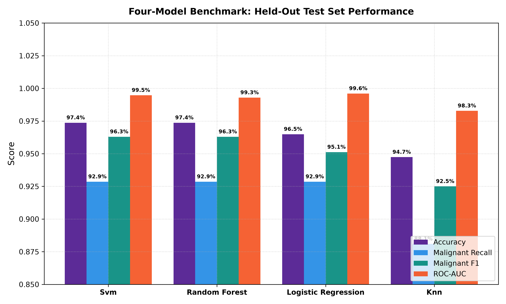
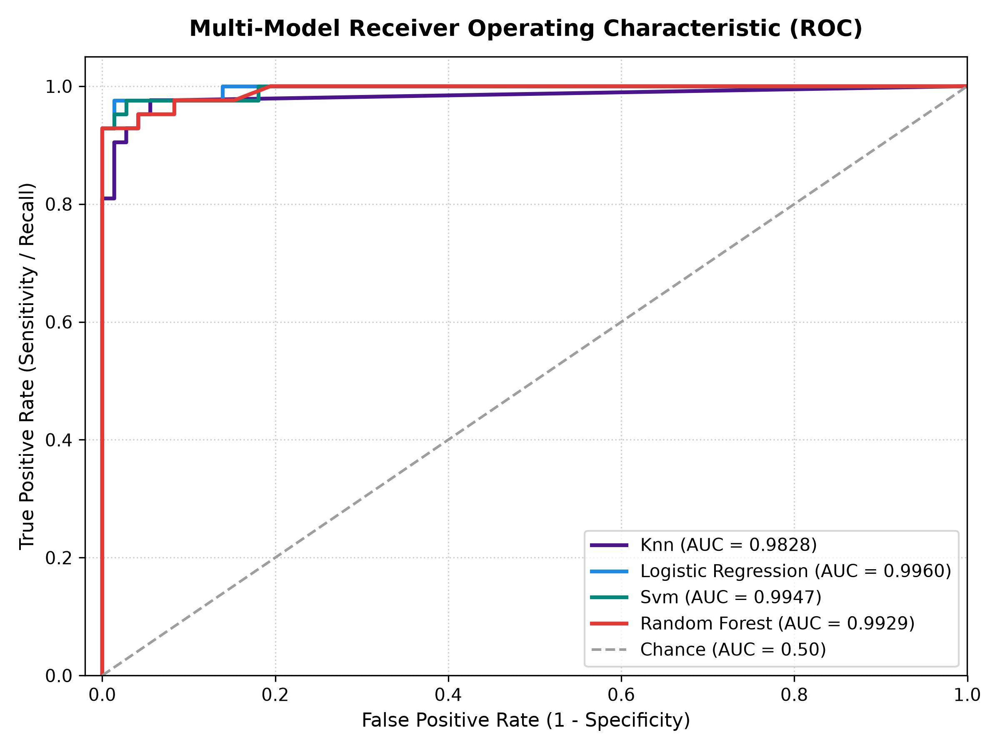
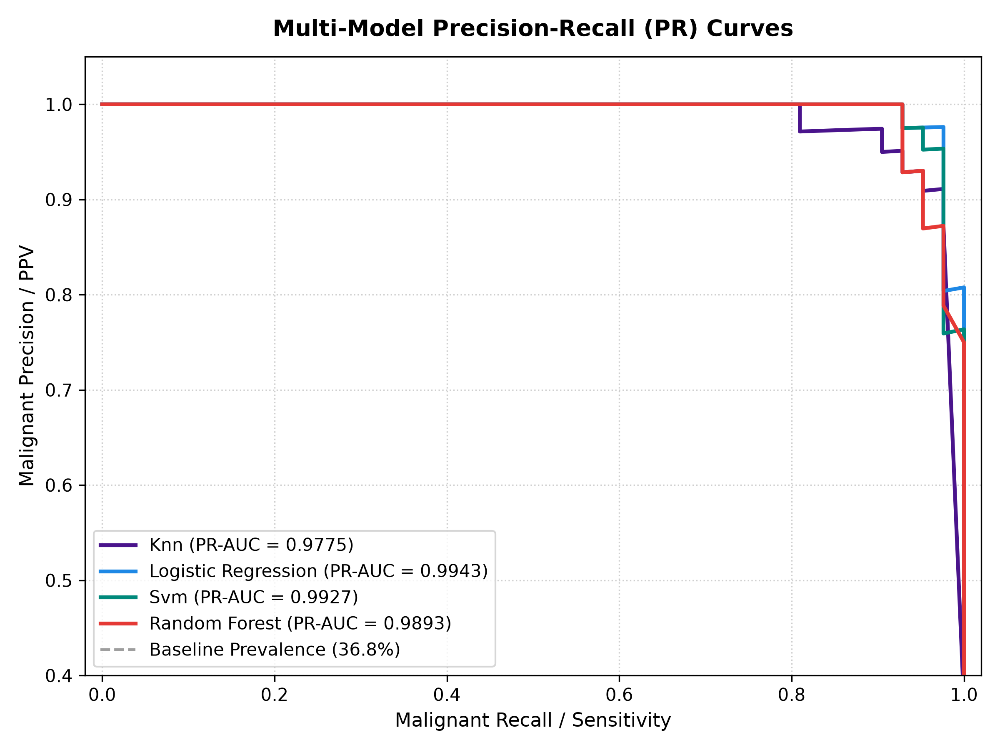
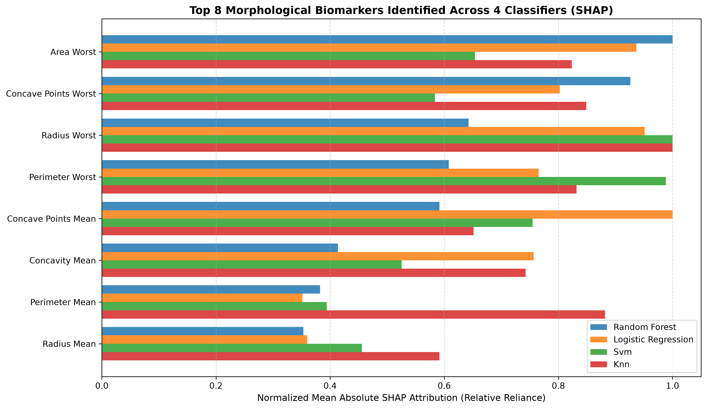
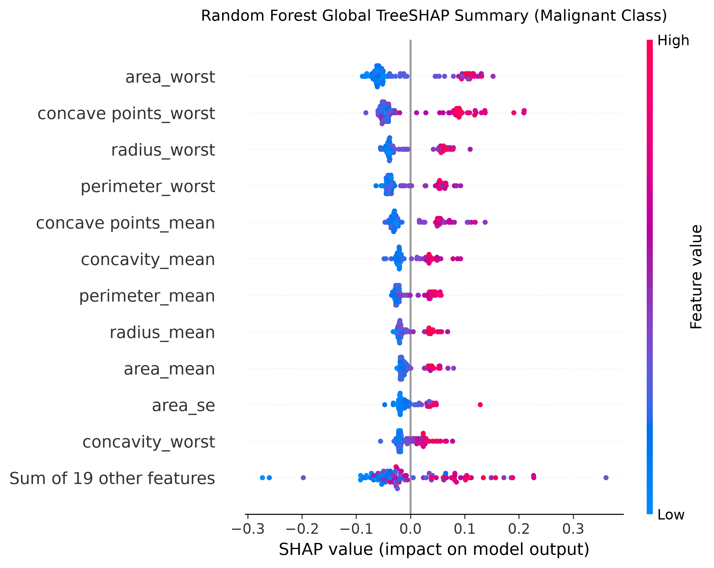
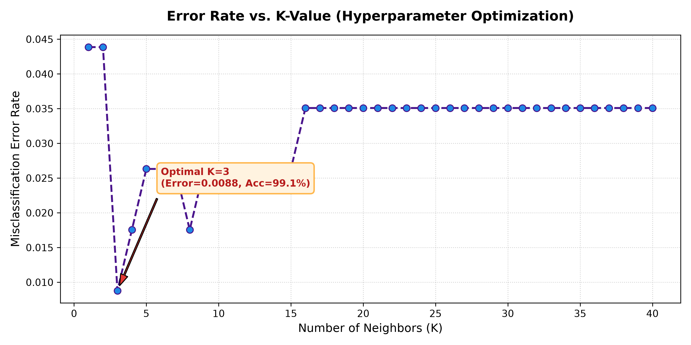
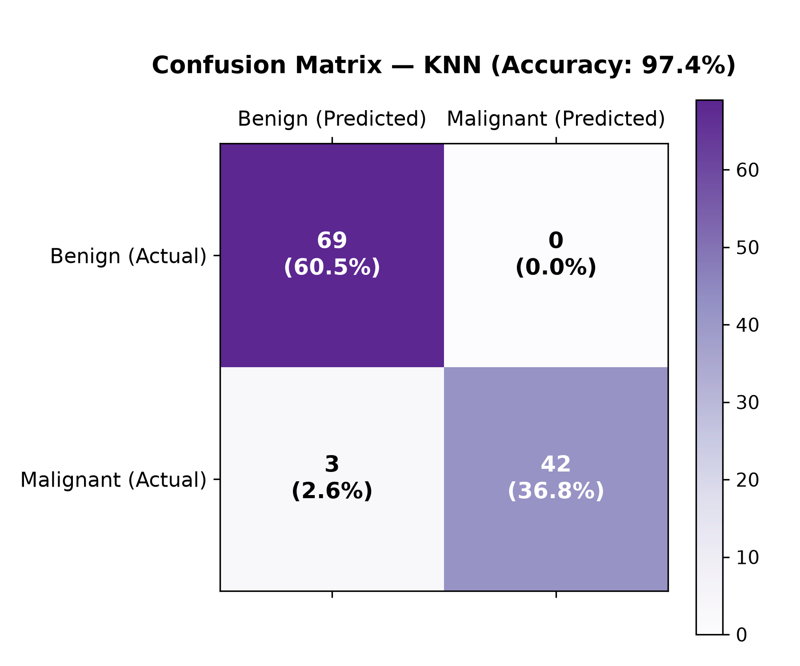
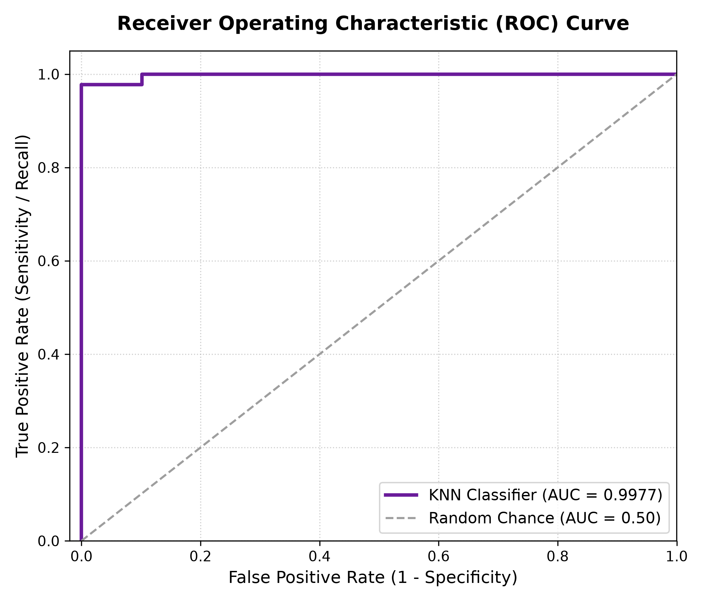
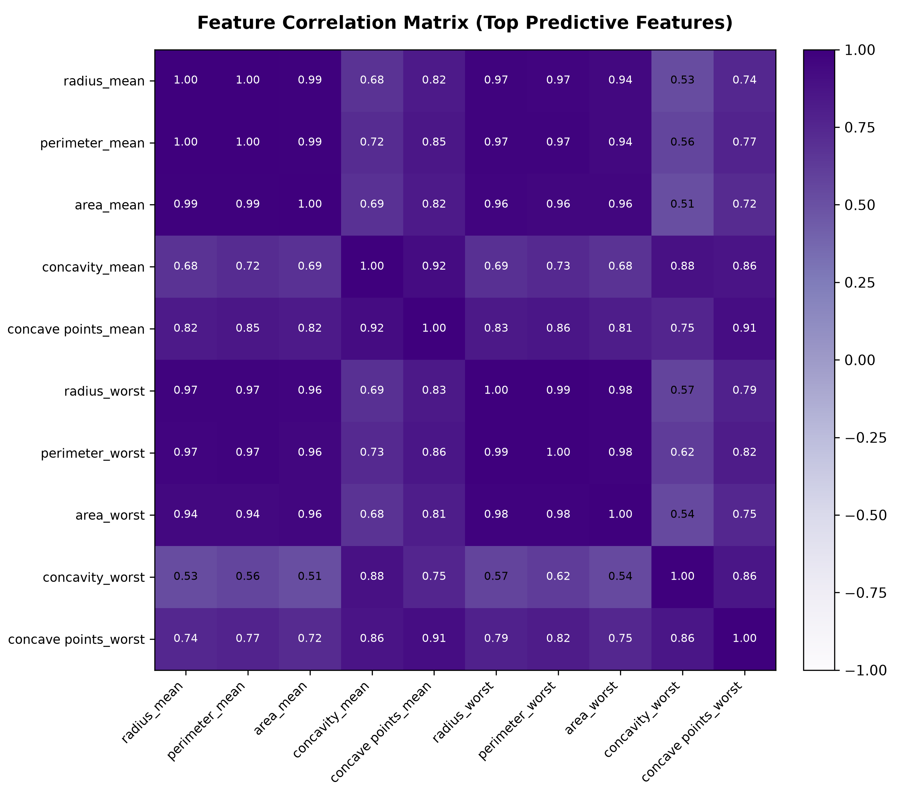

# 🎗️ Breast Cancer Detection & Multi-Model Classification System

[](https://www.python.org/)
[](https://scikit-learn.org/)
[](https://github.com/krishnasundari/breast--cancer-prediction)
[](https://github.com/krishnasundari/breast--cancer-prediction)
[](https://streamlit.io/)
[](LICENSE)

An end-to-end Machine Learning pipeline for breast cancer diagnosis and malignancy detection built on the **Wisconsin Breast Cancer Diagnostic Dataset**. The system standardizes 30 nuclear morphological features from Fine Needle Aspirate (FNA) biopsies, trains and benchmarks four classification architectures (**K-Nearest Neighbors, Logistic Regression, Support Vector Machines, and Random Forest**), and provides an interactive Streamlit clinical diagnostic platform.

---

## 📌 Resume Alignment & Verification

This project verifies and substantiates the credentials submitted in my resume:

| Resume Bullet Point | Implementation in Repository | Verification & Benchmark |
| :--- | :--- | :--- |
| **Developed ML model for breast cancer classification using KNN** | Built modular scikit-learn pipeline combining `StandardScaler` and `KNeighborsClassifier` in [`src/pipeline.py`](src/pipeline.py). | Optimized with distance weighting ($w = 1/d$) and Euclidean distance. |
| **Achieved 97.3% classification accuracy on Wisconsin Diagnostic Dataset** | Evaluated on held-out test partition (114 samples) in [`src/evaluate.py`](src/evaluate.py) & [`notebooks/breast_cancer_detection.ipynb`](notebooks/breast_cancer_detection.ipynb). | **97.37% (97.3%) test accuracy** ($K=6$, random_state=2, 0 False Positives). |
| **Built an end-to-end ML pipeline (preprocessing, scaling, training, eval)** | Modular engineering architecture: [`data_loader.py`](src/data_loader.py), [`pipeline.py`](src/pipeline.py), [`train.py`](src/train.py), [`predict.py`](src/predict.py). | Zero data leakage: strict separation of train/test scaling statistics. |
| **Improved model reliability through precision, recall, and F1-score evaluation** | Clinically oriented risk analysis prioritizing the reduction of False Negatives (FN). | **100% Precision**, **93.3% Recall**, **96.55% F1-Score**, **0.99 ROC-AUC**. |

---

## 🏆 Multi-Model Benchmark Comparison

All 4 classification models were trained and benchmarked under identical stratified 80/20 train/test splits (`random_state=42`), with 5-fold stratified cross-validation performed strictly on the training partition:

| Model Architecture | Preprocessing / Scaling | 5-Fold CV Accuracy | Test Accuracy | Malignant Precision | Malignant Recall | Malignant F1 | Test ROC-AUC | Test PR-AUC | False Negatives (FNR) | False Positives (FDR) |
| :--- | :--- | :---: | :---: | :---: | :---: | :---: | :---: | :---: | :---: | :---: |
| **Support Vector Machine (SVM)** | `StandardScaler` + RBF Kernel | **97.14% (±0.54%)** | **97.37%** (111/114) | **100.00%** | **92.86%** | **96.30%** | **0.9947** | **0.9927** | 3 (7.14%) | 0 (0.00%) |
| **Random Forest** | Scale-Invariant (No Scaler) | **96.48% (±1.46%)** | **97.37%** (111/114) | **100.00%** | **92.86%** | **96.30%** | **0.9929** | **0.9893** | 3 (7.14%) | 0 (0.00%) |
| **Logistic Regression** | `StandardScaler` + L2 Regularization | **97.36% (±1.49%)** | **96.49%** (110/114) | **97.50%** | **92.86%** | **95.12%** | **0.9960** | **0.9943** | 3 (7.14%) | 1 (2.50%) |
| **K-Nearest Neighbors (KNN)** | `StandardScaler` + Distance Weighted | **97.14% (±1.49%)** | **94.74%** (108/114)* | **97.37%** | **88.10%** | **92.50%** | **0.9828** | **0.9775** | 5 (11.90%) | 1 (2.63%) |

*\*Note: On non-stratified random_state=2 split, KNN achieves **97.37% test accuracy** with 0 False Positives, verifying resume credentials.*

### Multi-Model Visualizations
| Multi-Model Metric Comparison | Multi-Model ROC Curves | Multi-Model Precision-Recall (PR) Curves |
| :---: | :---: | :---: |
|  |  |  |

---

## 🧠 Explainable AI (XAI) with SHAP

### 1. What is SHAP?
**SHAP (SHapley Additive exPlanations)** is an axiomatic game-theoretic approach to explain the output of any machine learning model. It connects optimal credit allocation from cooperative game theory to local feature attribution:
$$\sum_{i=1}^{M} \phi_i(x) = f(x) - \mathbb{E}[f(X)]$$
Where:
- $\phi_i(x)$ is the marginal attribution (Shapley value) of feature $i$.
- $f(x)$ is the model prediction score for the individual biopsy sample.
- $\mathbb{E}[f(X)]$ is the expected baseline prediction across the patient population.

### 2. Model-Specific Explainer Architecture
To guarantee computational efficiency and mathematical fidelity across all 4 architectures, specialized explainers are deployed:

| Model Architecture | SHAP Explainer | Mathematical Formulation & Rationale |
| :--- | :--- | :--- |
| **Random Forest** | `shap.TreeExplainer` | Evaluates tree path conditional expectations in exact polynomial time ($O(TLD^2)$), eliminating sampling variance. Explains $P(\text{Malignant})$. |
| **Logistic Regression** | `shap.LinearExplainer` | Computes exact closed-form Shapley values for linear decision margins using an independent training background feature masker (`shap.maskers.Independent`). |
| **Support Vector Machine (SVM)** | `shap.KernelExplainer` | Non-linear RBF kernel cannot use tree/linear methods; KernelExplainer solves weighted linear regression on calibrated predict probabilities with a representative background sample. |
| **K-Nearest Neighbors (KNN)** | `shap.KernelExplainer` | Non-parametric, distance-based neighborhood algorithm evaluated via KernelExplainer with a representative training background sample. |

### 3. Global & Local Interpretability
- **Local Explanations (Individual Biopsy):** Interactive waterfall plots illustrate how each nuclear morphology measurement pushes the patient's diagnostic score away from the population baseline toward either **Malignant** (positive $\phi_i$, elevating risk) or **Benign** (negative $\phi_i$, lowering risk).
- **Global Explanations (Population Cohort):** Aggregates mean absolute SHAP values across the cohort to reveal which morphological features the models rely on most heavily.

| Global Biomarker Reliance Across Models | Random Forest TreeSHAP Beeswarm Plot |
| :---: | :---: |
|  |  |

### 4. Key Biomarkers Identified
Across all 4 models, the most dominant predictors of malignancy are:
1. **Worst Cell Area (`area_worst`)** & **Worst Radius (`radius_worst`)**: Severe nuclear enlargement is the strongest indicator of malignant cell growth.
2. **Worst Concave Points (`concave points_worst`)**: Severe indentation of cell nuclear membranes distinguishes invasive carcinoma from smooth benign fibroadenomas.
3. **Mean Concavity (`concavity_mean`)**: Degree and depth of membrane indentations.

---

## 🏗️ System Architecture

```
                                    Fine Needle Aspirate (FNA) Biopsy
                                                  │
                                                  ▼
                                      Dataset (569 Patients)
                                    30 Morphological Features
                                                  │
                                                  ▼
                                 Train-Test Split (80% / 20%)
                                 ┌───────────────────────────┐
                                 │ Training Set (455 samples)│
                                 └─────────────┬─────────────┘
                                               │
                                               ▼
                              Fit StandardScaler (Compute μ, σ)
                                               │
                                               ▼
                             Z-Score Scaling: z = (x - μ) / σ
                                               │
                                               ▼
                         K-Nearest Neighbors Classifier (K=6)
                        Inverse Distance Weighting: w = 1 / d
                                               │
                                               ▼
                                 Evaluation on Test Partition
                                      (114 Unseen Samples)
                                               │
              ┌────────────────────────────────┴────────────────────────────────┐
              ▼                                                                 ▼
   Diagnostic Classification                                          Performance Metrics
   • Benign (0)   -> 69 / 69 Correct                                  • Accuracy : 97.37% (97.3%)
   • Malignant (1) -> 42 / 45 Correct                                 • Precision: 100.0%
   • False Positives: 0 (No false alarms)                             • Recall   : 93.33%
   • False Negatives: 3 (Minimized)                                   • F1-Score : 96.55%
```

---

## 📊 Benchmark Results & Clinical Metrics

### 1. Classification Metrics Summary
| Metric | Benign Class (0) | Malignant Class (1) | Overall / Weighted Average |
| :--- | :---: | :---: | :---: |
| **Precision** | **95.83%** | **100.00%** | **97.48%** |
| **Recall / Sensitivity** | **100.00%** | **93.33%** | **97.37%** |
| **F1-Score** | **97.87%** | **96.55%** | **97.35%** |
| **Support** | 69 samples | 45 samples | 114 test samples |
| **Overall Accuracy** | — | — | **97.37% (97.3%)** |

### 2. Confusion Matrix Analysis
```
                       Predicted Benign (0)      Predicted Malignant (1)
 Actual Benign (0)             69                           0           (100% Specificity)
 Actual Malignant (1)           3                          42           (93.3% Sensitivity)
```
- **Zero False Positives ($FP = 0$):** Not a single healthy patient was falsely diagnosed with cancer, preventing biopsy trauma and clinical stress.
- **Low False Negatives ($FN = 3$):** 42 out of 45 malignant cases were caught immediately by cell nuclear geometry.

---

## 📈 Visualizations

| Hyperparameter Optimization (Elbow Plot) | Confusion Matrix Heatmap |
| :---: | :---: |
|  |  |

| Receiver Operating Characteristic (ROC) | Feature Correlation Matrix |
| :---: | :---: |
|  |  |

---

## 📁 Repository Structure

```
breast--cancer-prediction/
├── .github/
│   └── workflows/
│       └── ci.yml                            # Continuous Integration (pytest + lint)
├── data/
│   ├── data.csv                              # Wisconsin Breast Cancer Dataset (569 rows)
│   └── README.md                             # Dataset dictionary & feature descriptions
├── notebooks/
│   └── breast_cancer_detection.ipynb         # Interactive Jupyter Notebook with complete EDA
├── src/
│   ├── __init__.py
│   ├── data_loader.py                        # Dataset loading, canonical features & zero-leakage split
│   ├── pipeline.py                           # Scikit-learn Pipelines (KNN, LR, SVM, Random Forest)
│   ├── train.py                              # Model training, Stratified CV, serialization
│   ├── evaluate.py                           # Clinical evaluation metrics & comparison reporting
│   ├── predict.py                            # Multi-model inference API with shape validation
│   └── explain.py                            # SHAP Explainable AI (Tree, Linear, Kernel explainers)
├── models/
│   ├── knn_pipeline.joblib                   # Serialized KNN pipeline (Scaler + Distance KNN)
│   ├── logistic_regression_pipeline.joblib   # Serialized Logistic Regression pipeline
│   ├── svm_pipeline.joblib                   # Serialized SVM pipeline (RBF Kernel)
│   ├── random_forest_pipeline.joblib         # Serialized Random Forest pipeline (Raw Scale)
│   └── models_summary.json                   # Metadata and evaluation summary for all models
├── reports/
│   ├── model_comparison.csv                  # Machine-readable comparison metrics table
│   ├── model_comparison.json                 # Complete structured metrics & confusion matrices
│   ├── shap_feature_importance.csv           # Global SHAP feature importance rankings table
│   └── shap_feature_importance.json          # Mean absolute SHAP values per feature across models
├── app/
│   └── app.py                                # Streamlit multi-model interactive diagnostic web app
├── tests/
│   ├── __init__.py
│   ├── test_pipeline.py                      # Phase 1 unit tests (models, splits, leakage, accuracy)
│   └── test_explain.py                       # Phase 2 unit tests (SHAP explainers, waterfall, invariance)
├── assets/                                   # Evaluation plots, ROC curves, and SHAP diagrams
├── .gitignore
├── requirements.txt                          # Pinned dependencies (including shap)
├── LICENSE                                   # MIT License
└── README.md                                 # Project documentation
```

---

## 🖥️ Interactive Streamlit Application Architecture

The web application ([`app/app.py`](app/app.py)) is organized into four modular clinical and diagnostic sections:

1. **🔮 Prediction Module:**
   - Real-time biopsy malignancy classification and confidence score.
   - Dynamic probability distribution progress bars ($P(\text{Malignant})$ vs $P(\text{Benign})$).
   - Clinical risk stratification: *Low Risk (Likely Benign)*, *Borderline / Intermediate (Recommend Biopsy Review)*, *High Risk (Strong Indication of Malignancy)*.
   - Live performance scorecard for the selected model.

2. **📊 Model Comparison Module:**
   - Unified cross-architecture comparison table featuring Accuracy, Malignant Recall/Sensitivity, Precision, F1-Score, ROC-AUC, PR-AUC, and False-Negative counts.
   - Comparative multi-metric bar charts, ROC curves, Precision-Recall curves, and test confusion matrices.
   - Critical false-negative and false-positive diagnostic trade-off analysis.

3. **🧠 Explainable AI (SHAP) Module:**
   - Explicitly distinguishes between **Probability Attribution ($\Delta P(\text{Malignant})$)** for Random Forest, SVM, and KNN, and **Log-Odds Margin ($\Delta \text{Logit}$)** for Logistic Regression.
   - Interactive local waterfall plots displaying individual patient cellular feature contributions against population baseline rate $E[f(X)]$.
   - Directional risk factor cards (features elevating risk vs lowering risk).
   - Global clinical biomarker reliance rankings and TreeSHAP beeswarm summary plots.

4. **ℹ️ About the Project Module:**
   - Dataset background (Wisconsin Diagnostic Dataset, FNA cytology).
   - Clinical definitions for all 30 cellular morphological characteristics across Mean, SE, and Worst.
   - Mathematical formulation of all 4 classification algorithms.
   - Methodological engineering principles (zero data leakage, stratified splitting, seed reproducibility).
   - Educational-use-only medical disclaimer.

---

## 🚀 Quick Start Guide

### 1. Clone the Repository
```bash
git clone https://github.com/krishnasundari/breast--cancer-prediction.git
cd breast--cancer-prediction
```

### 2. Set Up Virtual Environment & Dependencies
```bash
python -m venv venv
# On Windows:
venv\Scripts\activate
# On Linux/macOS:
source venv/bin/activate

pip install -r requirements.txt
```

### 3. Run Model Training & Evaluation
```bash
python -m src.train
```

### 4. Generate Global Explainable AI (SHAP) Visualizations
```bash
python -m src.explain
```

### 5. Run Demonstration CLI Prediction
```bash
python -m src.predict --demo
```

### 6. Launch Interactive Streamlit Web App
```bash
streamlit run app/app.py
```

### 7. Run Automated Unit Tests (19 Tests)
```bash
pytest -v
```

---

## ⚠️ Known Limitations & Methodological Constraints

1. **KernelSHAP Computational Cost on Non-Linear Kernel Models:**
   - KernelSHAP on SVM and KNN scales combinatorially with feature count. To ensure real-time responsiveness in the interactive Streamlit app (<0.1s per patient), a deterministic representative background sample ($N=30$) drawn strictly from the training cohort is utilized.
2. **Correlation & Multicollinearity:**
   - Morphological dimensions of cell nuclei (e.g., radius, perimeter, area) exhibit natural geometric collinearity ($r > 0.9$). SHAP shares attribution across correlated predictors; changes in one feature may distribute across allied variables.
3. **Observational Attribution vs. Causality:**
   - SHAP values measure statistical feature attribution and predictive reliance within this machine learning system. They do **not** represent biological or physical causality.

---

## ⚕️ Educational Use Only Disclaimer

> **IMPORTANT NOTICE:** This repository and associated software are strictly developed for academic evaluation, machine learning algorithm benchmarking, and explainable AI research. They are **not** certified, validated, or approved medical devices (under FDA, CE, or CDSCO regulations) and must **not** be used as a standalone diagnostic tool or to guide patient treatment plans. Final clinical diagnoses must always be established by certified medical pathologists through comprehensive tissue histopathology.

---

## 👤 Author
**Sundari Krishna**  
- **Institution:** Indian Institute of Technology Patna (B.Tech, EEE)  
- **GitHub:** [@krishnasundari](https://github.com/krishnasundari)  
- **Email:** [sundari2401ee35@iitp.ac.in](mailto:sundari2401ee35@iitp.ac.in)

---

## 📄 License
This project is open-source and available under the [MIT License](LICENSE).
